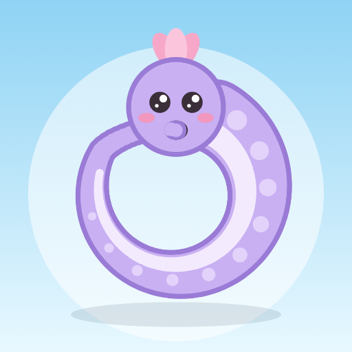

{: width="128"}

# Uroboros

Apps y juegos para Android · Android apps and games

## Nuestras apps · Our apps

| App | Tipo · Type | Documentos legales · Legal |
|---|---|---|
| **Uroboros: Snake Adventure** | Juego · Game | [Privacidad / Privacy](snake-adventure/privacidad/) · [Términos / Terms](snake-adventure/terminos/) |
| **Zombarricade: Zombie Defense** | Juego · Game | [Privacidad / Privacy](zombarricade/privacidad/) · [Términos / Terms](zombarricade/terminos/) |
| **Crow & Gems** | Juego · Game | [Privacidad / Privacy](crow-gems/privacidad/) · [Términos / Terms](crow-gems/terminos/) |
| **Star Drifter: Naves Espaciales · Space Shooter** | Juego · Game | [Privacidad / Privacy](star-drifter/privacidad/) · [Términos / Terms](star-drifter/terminos/) |
| **Games Uroboros: Board Classics** | Juegos de mesa · Board games | [Privacidad / Privacy](board-classics/privacidad/) · [Términos / Terms](board-classics/terminos/) |
| **Aventura en Tailandia · Thailand Adventure** | Juego · Game | [Privacidad / Privacy](aventura-tailandia/privacidad/) · [Términos / Terms](aventura-tailandia/terminos/) |
| **Glotones por Tailandia · Gluttons in Thailand** | Guía · Guide | [Privacidad / Privacy](glotones-tailandia/privacidad/) · [Términos / Terms](glotones-tailandia/terminos/) |
| **Puzzle Uroboros: Aprende Kanji · Learn Kanji** | Educación · Education | [Privacidad / Privacy](aprende-kanji/privacidad/) · [Términos / Terms](aprende-kanji/terminos/) |
| **Puzzle Uroboros: Tailandés · Thai** | Educación · Education | [Privacidad / Privacy](aprende-tailandes/privacidad/) · [Términos / Terms](aprende-tailandes/terminos/) |
| **QuiZ Uroboros: Aprende Idiomas** | Educación · Education | [Privacidad / Privacy](https://gist.github.com/quizuroboros-droid/3b5275cd4a73bb5ba1a638ec7c99f9c9) · [Términos / Terms](https://gist.github.com/quizuroboros-droid/6a0c38dd381ce5b78b1940553e1e35e0) |

Contacto / Contact: **quizuroboros@gmail.com**
